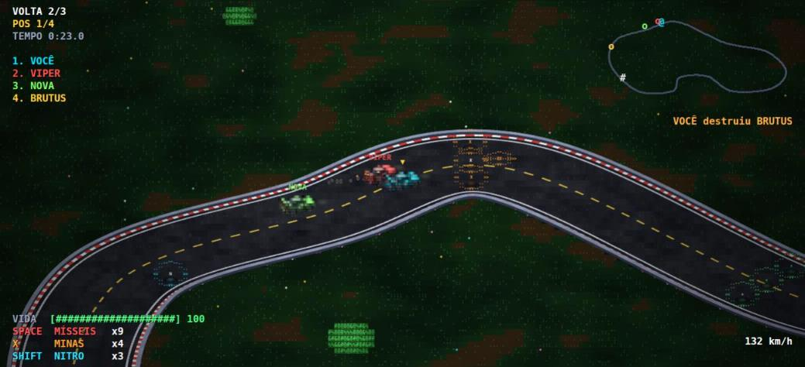
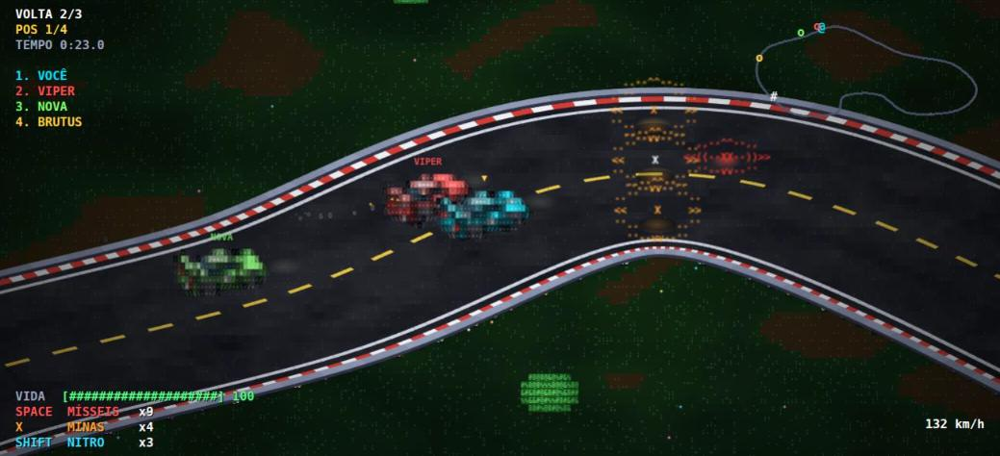
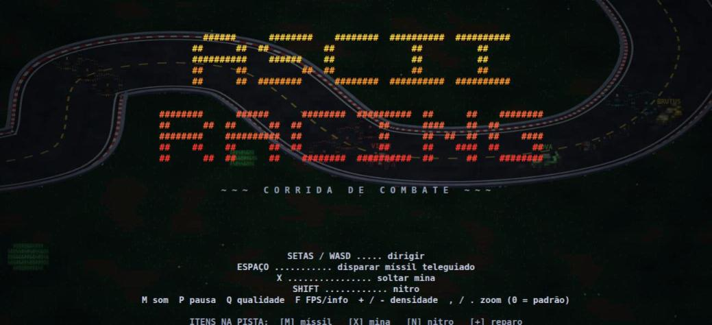

<h1 align="center">ASCII Racing</h1>

<p align="center"><strong>Isometric combat racing, drawn entirely in ASCII.</strong></p>

<p align="center">
  <strong>English</strong> · <a href="README.pt-BR.md">Português (Brasil)</a>
</p>

<p align="center">
  <a href="https://gamestudio42.github.io/ascii-racing/"><strong>▶ Play now: gamestudio42.github.io/ascii-racing</strong></a>
</p>

<p align="center">
  <a href="https://gamestudio42.github.io/ascii-racing/"></a>
  <a href="https://github.com/gamestudio42/ascii-racing/stargazers"></a>
  <a href="https://github.com/gamestudio42/ascii-racing/fork"></a>
  <a href="https://github.com/gamestudio42"></a>
  <a href="LICENSE"></a>
</p>

<p align="center">
  A combat racer in the spirit of <em>Rock'n Roll Racing</em> that runs in the browser.
  Race three rivals over three laps, grab power-ups, and blow them off the track —
  and every single thing on screen, from the asphalt to the cars, is made of text characters.
  No install, no build step, no dependencies.
</p>

<p align="center">
  <a href="https://gamestudio42.github.io/ascii-racing/">
    
  </a>
</p>

## Why ASCII Racing

- **Play in the browser.** Open the link and press <kbd>Enter</kbd>. Nothing to download.
- **Everything is ASCII.** The cars are small 3D models rotated in isometric view and converted to characters — edges become `-` `|` `/` `\`, surfaces become `-` `+` `#` hatching — so they look right from every angle.
- **Combat racing.** Homing missiles, mines, nitro and repair pickups. Wrecked cars respawn, and the rivals fight back.
- **A living track.** Kerbs, edge lines, a dashed centre line, a chequered start line and a low wall that follows every bend, all crisp at any zoom.
- **Runs on modest hardware.** The terrain is generated in chunks as you drive, the cars are pre-rendered sprites, and the game lowers its own quality if it starts to stutter.
- **No external assets.** The art is generated by code and the sound is synthesized with the Web Audio API.
- **Five languages.** English, Portuguese, Spanish, French and German. The game picks your browser's language, and <kbd>L</kbd> switches it on the fly.

<p align="center">
  
</p>

<p align="center">
  
</p>

## Controls

| Key | Action |
|---|---|
| Arrow keys / WASD | Drive |
| Space | Fire a homing missile |
| X | Drop a mine |
| Shift | Nitro |
| Enter | Start / restart |
| P | Pause |
| M | Sound on / off |
| Q | Quality: High / Medium / Low |
| F | Show FPS, zoom and quality |
| L | Change language (English / Português / Español / Français / Deutsch) |
| `+` / `-` | ASCII density (smaller / larger characters) |
| `,` / `.` | Camera zoom out / in — `0` resets it |

Pickups on the track: **[M]** missiles · **[X]** mines · **[N]** nitro · **[+]** repair.

## Run it locally

```bash
python3 -m http.server 8000
# open http://localhost:8000
```

Any static file server works. There is nothing to install.

## Project layout

```
index.html          loads the scripts
js/game.js          game logic, terrain, camera and rendering
js/i18n.js          translations (en, pt, es, fr, de)
sprites/            the art, one file per kind of thing — see sprites/LEIAME.md
  car.js            the car: a 3D model made of boxes
  props.js          pickups, mines and the missile
  terrain.js        asphalt, grass, trees and the wall colours
  iso.js            engine: 3D model -> isometric -> ASCII
  baked.js          loads the pre-rendered cars
  baked/            car sprite sheets (generated by tools/bake.html)
tools/
  bake.html         renders the car sprite sheets to PNG
  save_server.py    tiny local server that saves the PNGs
```

### Rebuilding the car sprites

After changing the car model or colours in `sprites/car.js`:

1. `python3 -m http.server 8123`, and in another terminal `python3 tools/save_server.py`.
2. Open `http://127.0.0.1:8123/tools/bake.html` and wait for **PRONTO** (about 10 seconds).
3. Reload the game and commit the new files in `sprites/baked/`.

Parameters and details are in [`sprites/LEIAME.md`](sprites/LEIAME.md) (in Portuguese).

## Contributing

Ideas, bug reports and pull requests are welcome — see [CONTRIBUTING.md](CONTRIBUTING.md).

## License

ASCII Racing is free software under the [GNU Affero General Public License v3.0](LICENSE).
If you run a modified version as a network service, the AGPL requires you to offer its source to the users of that service.
