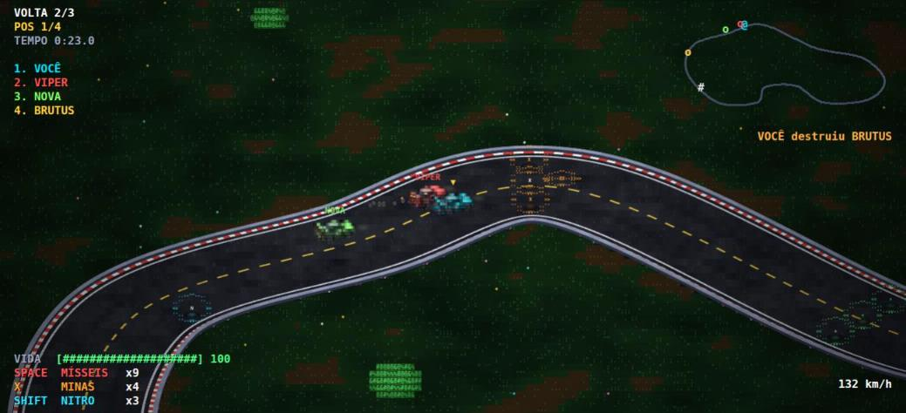
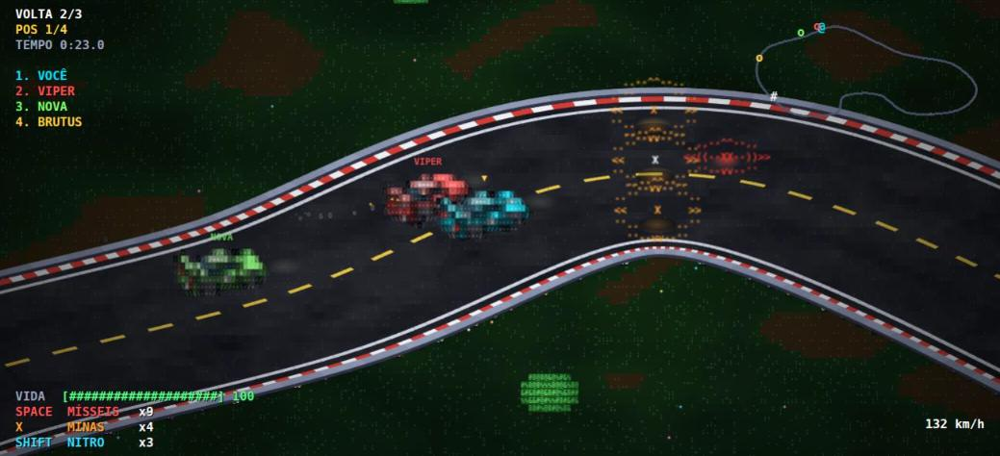
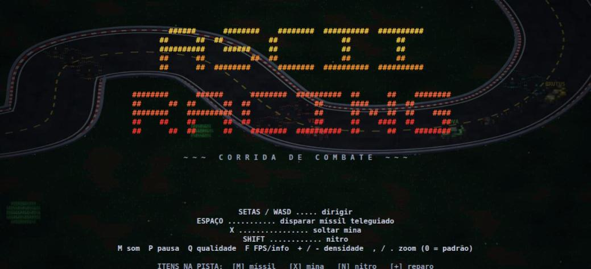

<h1 align="center">ASCII Racing</h1>

<p align="center"><strong>Corrida de combate isométrica, desenhada toda em ASCII.</strong></p>

<p align="center">
  <a href="README.md">English</a> · <strong>Português (Brasil)</strong>
</p>

<p align="center">
  <a href="https://gamestudio42.github.io/ascii-racing/"></a>
  <a href="https://github.com/gamestudio42/ascii-racing/stargazers"></a>
  <a href="https://github.com/gamestudio42/ascii-racing/fork"></a>
  <a href="https://github.com/gamestudio42"></a>
  <a href="LICENSE"></a>
</p>

<p align="center">
  Uma corrida de combate no espírito de <em>Rock'n Roll Racing</em>, que roda no navegador.
  Corra três voltas contra três rivais, pegue itens e tire todo mundo da pista —
  e tudo o que aparece na tela, do asfalto aos carros, é feito de caracteres de texto.
  Sem instalar, sem build, sem dependências.
</p>

<p align="center">
  <a href="https://gamestudio42.github.io/ascii-racing/">
    
  </a>
</p>

## Por que ASCII Racing

- **Joga no navegador.** Abra o link e aperte <kbd>Enter</kbd>. Nada para baixar.
- **Tudo é ASCII.** Os carros são pequenos modelos 3D girados em visão isométrica e convertidos em caracteres — as bordas viram `-` `|` `/` `\` e as superfícies viram hachura de `-` `+` `#` — por isso ficam certos em qualquer ângulo.
- **Corrida de combate.** Mísseis teleguiados, minas, nitro e itens de reparo. Carros destruídos voltam à pista, e os rivais revidam.
- **Uma pista viva.** Zebras, linhas laterais, linha central pontilhada, linha de largada xadrez e um muro baixo que acompanha toda curva, tudo nítido em qualquer zoom.
- **Roda em máquinas modestas.** O terreno é gerado em blocos enquanto você dirige, os carros são sprites pré-gerados, e o jogo reduz a própria qualidade se começar a travar.
- **Sem arquivos externos de arte ou som.** A arte é gerada por código e o som é sintetizado com a Web Audio API.
- **Cinco idiomas.** Inglês, português, espanhol, francês e alemão. O jogo usa o idioma do seu navegador, e a tecla <kbd>L</kbd> troca na hora.

<p align="center">
  
</p>

<p align="center">
  
</p>

## Controles

| Tecla | Ação |
|---|---|
| Setas / WASD | Dirigir |
| Espaço | Disparar míssil teleguiado |
| X | Soltar mina |
| Shift | Nitro |
| Enter | Começar / recomeçar |
| P | Pausa |
| M | Som ligado / desligado |
| Q | Qualidade: Alta / Média / Baixa |
| F | Mostra FPS, zoom e qualidade |
| L | Troca o idioma (English / Português / Español / Français / Deutsch) |
| `+` / `-` | Densidade do ASCII (caracteres menores / maiores) |
| `,` / `.` | Zoom da câmera: afasta / aproxima — `0` volta ao padrão |

Itens na pista: **[M]** mísseis · **[X]** minas · **[N]** nitro · **[+]** reparo.

## Rodar localmente

```bash
python3 -m http.server 8000
# abra http://localhost:8000
```

Qualquer servidor de arquivos estáticos serve. Não há nada para instalar.

## Estrutura

```
index.html          carrega os scripts
js/game.js          lógica do jogo, terreno, câmera e renderização
js/i18n.js          traduções (en, pt, es, fr, de)
sprites/            a arte, um arquivo para cada tipo de coisa — veja sprites/LEIAME.md
  car.js            o carro: um modelo 3D feito de caixas
  props.js          itens, minas e o míssil
  terrain.js        asfalto, grama, árvores e as cores do muro
  iso.js            motor: modelo 3D -> isométrico -> ASCII
  baked.js          carrega os carros pré-gerados
  baked/            sprites dos carros (gerados por tools/bake.html)
tools/
  bake.html         gera os sprites dos carros em PNG
  save_server.py    servidor local pequeno que grava os PNGs
```

### Refazer os sprites dos carros

Depois de mexer no modelo ou nas cores do carro em `sprites/car.js`:

1. `python3 -m http.server 8123` e, em outro terminal, `python3 tools/save_server.py`.
2. Abra `http://127.0.0.1:8123/tools/bake.html` e espere aparecer **PRONTO** (uns 10 segundos).
3. Recarregue o jogo e faça o commit dos novos arquivos em `sprites/baked/`.

Parâmetros e detalhes em [`sprites/LEIAME.md`](sprites/LEIAME.md).

## Contribuindo

Ideias, relatos de bugs e pull requests são bem-vindos — veja o [CONTRIBUTING.md](CONTRIBUTING.md).

## Licença

ASCII Racing é software livre sob a [GNU Affero General Public License v3.0](LICENSE).
Se você executar uma versão modificada como serviço de rede, a AGPL exige que você ofereça o código-fonte dela aos usuários desse serviço.
